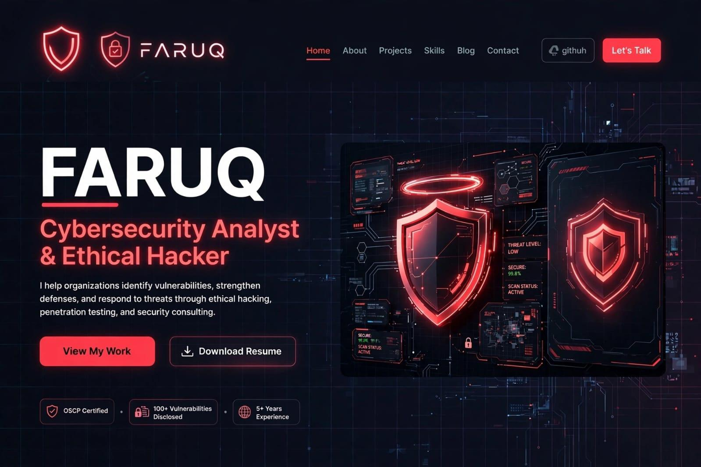

# 🛡️ FARUQ - Cybersecurity Analyst | addyfaruq704-gif.github.io

**Live Portfolio:** https://addyfaruq704-gif.github.io/

📧 addyfaruq704@gmail.com | 📱 0791141182 | 📍 Eldoret, Kenya

### 🔥 Current Learning Progress

**15/99 Completed | 15 Concepts | 7 CTFs**

#### ✅ Completed Today
- ✅ Cybersecurity Fundamentals - 100% (10/10)
- ✅ Daily Challenge: The Poisoned Query (SQL Injection) +150 XP

#### 🔄 In Progress
- 🟢 Network Security & Architecture - 10% (1/10) - CURRENT
- ⚪ Web Application Attacks - 0% - NEXT (Pentesting $$)
- ⚪ Cryptography & Obfuscation - 0%

### 💻 Skills
Burp Suite | SQL Injection | XSS | Nmap | Metasploit | OWASP Top 10 | Python | Linux

### 📫 Hire Me
Web App Pentesting from KES 15k | Vulnerability Assessment from KES 10k
WhatsApp: https://wa.me/254791141182 | Response in 1 hour

